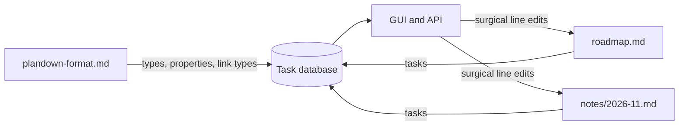
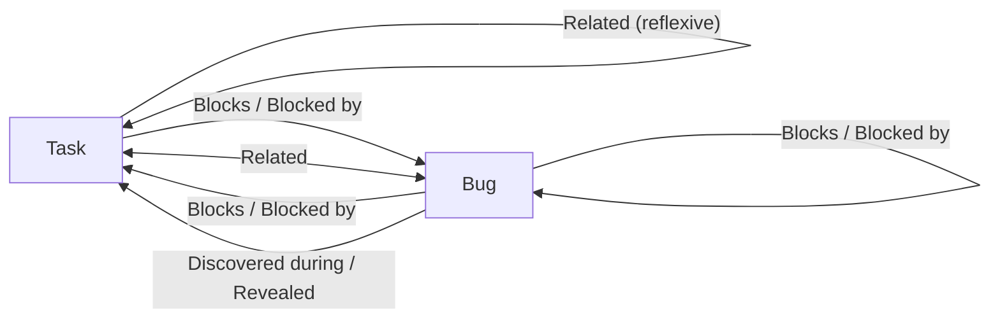

# The Plandown database

Plandown keeps all of its data in a folder of plain Markdown files. There is no hidden index and no cache: the files *are* the database. You can edit them in any text editor, keep them in version control, and Plandown picks up the changes immediately.

This document explains how Plandown reads that folder: which headings become tasks, how properties and links are written, and how the special `plandown-format.md` file defines what is allowed.

## The folder

Every `.md` file inside the folder and its subfolders is read. Hidden files and folders (names starting with `.`) are skipped, and symbolic links are not followed. One file has a special role:

- **`plandown-format.md`** at the top of the folder declares the task types, their properties and the link types between them. A file with that name inside a subfolder is ignored.
- **Every other `.md` file** holds tasks. Files are read in natural name order (`2.md` before `10.md`), and together they form one database. Subfolders only organize the files; a task's identity does not depend on where it is stored.

A task file may also end in `.plandown.md`. It is read like any other `.md` file, but editors can recognize it as a Plandown file by its name alone. Both suffixes count as the file's extension, so `roadmap.plandown.md` is named `roadmap` everywhere (and merges with a `roadmap/` folder). If `roadmap.md` and `roadmap.plandown.md` both exist, `roadmap.md` stands for the name in the navigation tree.



## Tasks

Every heading whose text starts with `[<Task type>]` is a task. The rest of the line is the task's title.

```markdown
# [Task] Pantry 1.0
## [Bug] Imported recipes lose their photos
```

A bullet point that starts with `[<Task type>]` does not define a task. It *refers* to one, and it is how lists link tasks together (see [Subtasks and links](#subtasks-and-links)):

```markdown
- [Task] Offline mode
1. [Task] Numbered items work too
- [x] [Task] A checkbox in front of the type is allowed
```

Every task therefore needs a heading of its own somewhere in the folder. A bullet that names a task without one is reported as an error, and its link is ignored.

Lines that do not start with a task type are ordinary Markdown and are left alone. A checkbox on its own (`- [x] Buy milk`) is not a reference, and neither is a link (`- [docs](https://example.com)`) or anything inside a fenced code block.

### Identity and interwoven files

A task is identified by its type and title together: `[Task] Offline mode`. Wherever that combination appears, in any file, it is the same task. This is how files interweave. A dated notes file can mention a task defined in the roadmap and add subtasks or links to it:

```markdown
# Notes for November

## [Task] Offline mode

### [Task] Sync status indicator
```

Because of this, titles must be unique within a task type. Two different tasks named `[Task] Cleanup` would be merged into one.

Each place a task appears (as a heading or as a bullet) is called an *occurrence*. The first heading that has properties or a description is the task's **home**, or the first heading if none has; that is where its properties and description are read from and where the GUI writes them back. The other occurrences only contribute links. If properties are written in more than one occurrence, Plandown uses the home's and reports a warning for the others.

### Top-level tasks

Tasks that are not nested under another task are top-level tasks. Usually these are the main (`#`) headings of each file. A task heading below a non-task heading (such as `# Notes for November` above) is top-level as well, unless a task heading encloses it.

## Properties

A YAML block right after a task's heading holds its properties. Indent the block by four spaces:

```markdown
## [Task] Offline mode
    Due-date: 2026-12-01
    Priority: 1
    effort: 16
    spent: 3.5

Recipes, shopping lists and edits keep working without a network and sync when it returns.
```

The block ends at the first line indented by less than four spaces, so the description continues at the left margin. It may also be closed explicitly by a `---` or `...` line (the YAML document markers), indented or not; that line belongs to the block, so a description cannot start with a `---` horizontal rule. A blank line after the block is customary but optional, and blank lines may also separate the block from the title or appear inside it. Markdown viewers render the block as an ordinary code block.

A fenced `yaml` code block works as well. Both fence styles are accepted (```` ``` ```` and `~~~`), and the language may be written as `yaml` or `yml`:

````markdown
## [Task] Choose an auth provider
```yaml
effort: 6
done: true
```
````

A missing closing fence is reported as an error; the search stops at the next task heading, so an unclosed block never swallows other tasks.

Note that the first block of a task's section is always read as its properties. To start a description with a code block, put the properties (or an empty fenced `yaml` block) above it.

YAML comments are allowed and are preserved when the GUI edits the block. The block is always written back indented and followed by a blank line, so editing the properties converts a fenced block.

Earlier versions delimited the block with two `---` lines directly below the title. That style is still read, but `plandown check` reports it as a warning, and the next edit of the task's properties rewrites it in the current style. It was replaced because most Markdown renderers (and formatters such as Prettier) turn the YAML above a closing `---` into a heading.

Which properties a task may have is declared by its type in `plandown-format.md`. In addition, every type has these built-in properties:

| Property | Type | Meaning |
|---|---|---|
| `done` | boolean | The task is finished. |
| `effort` | number | Estimated effort in hours. |
| `spent` | number | Time spent in hours. |
| `started` | datetime | Start of the running timer. Managed by the timer; stopping it (or logging the elapsed time) adds that time to `spent`. |

Undeclared properties are kept but reported as warnings; values of the wrong type are reported as errors.

## Description

The description is the text after the heading (and its property block). It runs up to the next task heading or the next heading of the same or a higher level, so ordinary sub-headings such as `### Notes` are sub-chapters of the description.

Lists that contain tasks are not part of the description text; they declare subtasks and links, as described below. The description may continue after them, and the GUI shows each list's links at the place where the list stands.

## Subtasks and links

Tasks are connected by *links*. Every link has a type, and every link type has a reverse: if task A `Blocks` task B, then B is `Blocked by` A. The pair Subtask and Parent is built in.

### Subtasks

There are two ways to make a subtask:

1. **Sub-headings.** A task heading nested under another task heading is its subtask, even with ordinary headings in between.
2. **Unlabeled lists.** A list of task references that has no `<Link type>:` line above it lists subtasks of the task it belongs to. The subtasks are defined by headings elsewhere, for example in a file of their own.

```markdown
# [Task] Pantry 1.0

## [Task] Offline mode

- [Task] Account system

### [Task] Design the sync protocol
```

Here `Offline mode` is a subtask of `Pantry 1.0`, and both `Account system` (defined by a heading elsewhere) and `Design the sync protocol` are subtasks of `Offline mode`. Each subtask in turn has its parent linked as `Parent`. A list labeled `Parent:` declares parents explicitly, and a list may also be labeled `Subtask:` (useful when it follows another list, see below).

A bullet is only a reference, so whatever is nested under it is plain Markdown. Plandown reports a warning when a reference carries a `yaml` block or nested task bullets, because those would otherwise be lost silently; give the task its own heading instead.

### Other link types

To use any other link type, write a paragraph line of the form `<Link type>:` above the list (blank lines between them are fine):

```markdown
## [Task] Offline mode

Blocked by:
- [Task] Account system
```

The label must be ordinary paragraph text. A heading such as `### Blocked by:` does not label the list below it: that list is read as a subtask list, and Plandown reports a warning.

Every entry refers to a task by its type and title, so `[Task] Account system` must have a heading somewhere in the folder.

Lists follow the CommonMark rules, so formatters such as Prettier can reformat them safely. Blank lines between items do not end a list, and items may span several paragraphs. A list ends at a line that is not part of it (such as the next label) or at a bullet with a different marker: `-`, `*` and `+` each start their own list, as do `1.` and `1)`. To put a subtask list right after another list, label it `Subtask:`; an unlabeled list after a blank line would simply continue the list above it. Plandown adds this label itself when the GUI appends such a list.

The same relation only needs to be written once. Writing `Blocked by: [Task] Account system` under Offline mode is equivalent to writing `Blocks: [Task] Offline mode` under Account system; if both are written, Plandown counts the link once.

## The format file

`plandown-format.md` uses the same Markdown structure as task files, with a different meaning:

- Each `# [<Task type>] <description>` heading **declares a task type**. The text after the type is a short description of it.
- The property block **declares the type's property schema**.
- Each labeled list **declares a link type** that tasks of this type can use. Every entry `[<Target type>] <Reverse link>` allows linking to tasks of the target type and names the link type that the target sees in the opposite direction.

```markdown
# [Task] A unit of planned work
    Due-date: date
    Priority:
      type: number
      enum: [1, 2, 3]

Blocks:
- [Task] Blocked by
- [Bug] Blocked by

Blocked by:
- [Task] Blocks
- [Bug] Blocks

Related:
- [Task] Related
- [Bug] Related
```

### Property schemas

Each property is declared either by its type name alone (`Due-date: date`) or as a mapping with these keys:

| Key | Meaning |
|---|---|
| `type` | One of `string`, `number`, `boolean`, `date` (`YYYY-MM-DD`) or `datetime` (ISO 8601). Required. |
| `enum` | A list of allowed values. The GUI shows them as a drop-down. |
| `description` | Help text shown as a tooltip in the GUI. |

The built-in properties (`done`, `effort`, `spent`, `started`) cannot be redeclared.

### Type settings

The reserved `$meta` key in a type's property block holds settings of the type itself rather than a property:

```markdown
# [Bug] A defect to fix
    $meta:
      color: crimson
    Severity: string
```

| Key | Meaning |
|---|---|
| `color` | Any CSS color. The GUI uses it for the type's badges and its "Create" button. Values the browser does not recognize are ignored. |

### Link types and their reverses

Every link has two names, one for each direction. The entry `[B] R` under link **L** of type **A** names both, so the reverse is known even when type **B** says nothing about it. Such a link is *one-directional*: tasks of type A can create it, and tasks of type B show it as an incoming `R` link but cannot create it from their side. A list labeled `R:` under a `[B]` task is then reported as an error.

To let both sides create the link, type **B** declares the reverse too. The two declarations must agree:

> When type **A** declares link **L** with the entry `[B] R`, and type **B** declares link **R** with an entry for `[A]`, that entry must be `[A] L`.

A **reflexive** entry (one pointing to its own type with the same link name, such as `Related:` with `- [Task] Related` under `[Task]`) reads the same in both directions, so it is always two-directional.

The diagram below shows the links declared by the example above, together with the `[Bug]` type from the demo folder. Each arrow is one declaration; the label is the link type and its reverse.



`Subtask` and `Parent` are built in, connect any two types, and cannot be redeclared.

## Validation

Plandown never refuses to load a folder. Instead it reports diagnostics (with file and line) for anything that does not match the format:

- In `plandown-format.md`: duplicate types, invalid property schemas, unlabeled lists, unknown target types, and reverse declarations that contradict each other.
- In task files: unknown task types, references to tasks that have no heading, link types the task's type does not declare, links to types the link type does not allow, tasks linking to themselves, invalid YAML, unclosed property blocks, property blocks in the old `---` style, properties or tasks nested under a reference bullet, headings used as list labels, undeclared properties and values that do not match their schema.

Run `plandown check <folder>` to print them; it exits with a non-zero status when there are errors, so it can guard a commit hook or a CI job.

## How edits are written

When a task is changed through the GUI or the library, Plandown rewrites only the lines involved: a heading, a property block, a description, or a single list item. Everything else in the file, including your formatting and comments, stays byte for byte the same. Before writing, Plandown checks that the file has not changed on disk since it was last read; if it has, the edit is refused and the folder is reloaded, so nothing written by someone else is overwritten.

Some changes are made where they are declared:

- **Renaming** a task (or changing its type) rewrites its title in every occurrence, in every file.
- **Creating a subtask** adds a sub-heading at the end of the parent's section. If that heading would have to be deeper than level 6, the subtask becomes a level-1 heading at the end of the file instead, and a reference to it is added to the parent's subtask list.
- **Adding a link** appends an entry to the matching list of the task's home occurrence, creating the `<Link type>:` list if needed.
- **Removing a link** deletes the list entry that declares it. When both tasks declare the same link, removing it from one task deletes only that task's entry; the other declaration remains. Links that come from heading nesting are changed by moving the heading.
- **Deleting a task** removes every occurrence: its heading sections, with everything nested inside them, and every reference to it.
