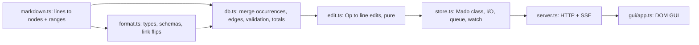

# Dev notes (local, not for release)

## Architecture

- Identity = `[Type] Title`. Home occurrence = first with props/desc.
- Edits are line-range replacements computed from the last parse; store refuses if disk text differs.
- `Parent` edges are normalized to `Subtask` (flipped) in `db.edges`.
- GUI imports types only; `api` object is the single transport seam.

## Decisions taken without asking

- Lists end at blank lines (no loose lists) so appended lists never merge into a labeled one.
- Non-colon text directly above a task list still yields Subtask (lenient).
- Undeclared `[X]` prefixes are tasks with an error, not ignored.
- Timer state stored in md (`started`), not in GUI memory.
- Built-ins: `done`, `effort`, `spent`, `started` (hours).
- Recursive folders (hidden ones skipped, symlinks not followed); natural sort on relative paths. Nested `mado-format.md` ignored (reserved for sub-formats).
- Sidebar tree (`tree.ts`) is built with the db, not in the GUI, so a VSCode TreeView can reuse it. Merges: file+folder by stem; file+single top-level task by slug (title or id). A task-merged node counts as a task for placement (new tasks and groups go next to it). Renaming a merged task renames its file and folder; collisions refuse the rename.
- Tree selection (`pick`) is separate from navigation (`sel`); `.sel` marks the picked row, `.cur` the open task.
- Description = body (`own`) minus task-list spans → `Task.body` alternates texts and `{ links }`. Heading body runs over non-task sub-headings. `update.body` is per gap; fewer texts than gaps keep trailing gaps (lists appended meanwhile), more texts are rejected.
- GUI editor (`gui/mdedit.ts`): live-preview over raw source (lossless), markers absolutely positioned outside what they mark, shown when caret near. Own undo stack (DOM is repainted per input). Shared fixed toolbox. Save/Revert page-wide in the title row; links save immediately into description slots refilled by `live()`.

## Roadmap

- VSCode extension: webview loads `dist/gui/*`, replace `api` with postMessage; `Mado.watch` or VSCode file watcher; map `db.diagnostics` to a DiagnosticCollection; "Stored in" entries open the file at line.
- Graph: dummy nodes for long edges (see `shortcut:` in app.ts).
- Time log per day (`spent` is a total today) if per-day allocation reports are needed.
- Sub-formats: `mado-format.md` inside a subfolder extending the root format for that subtree.
- Sidebar: collapsible folders; moving tasks between files.
- Editor: list continuation on Enter, per-line repaint for long descriptions, fuller CommonMark inline subset (see `shortcut:` in mdedit.ts).
