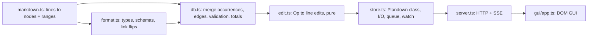

# Dev notes (local, not for release)

## Architecture

- Identity = `[Type] Title`. Home occurrence = first with props/desc.
- Edits are line-range replacements computed from the last parse; store refuses if disk text differs.
- `Parent` edges are normalized to `Subtask` (flipped) in `db.edges`.
- GUI imports types only; `api` object is the single transport seam.

## Decisions taken without asking

- Lists end at blank lines (no loose lists) so appended lists never merge into a labeled one.
- Non-colon text directly above a task list still yields Subtask (lenient).
- Undeclared `[X]` prefixes are tasks with an error, not ignored.
- Timer state stored in md (`started`), not in GUI memory.
- Built-ins: `done`, `effort`, `spent`, `started` (hours).
- Recursive folders (hidden ones skipped, symlinks not followed); natural sort on relative paths. Nested `plandown-format.md` ignored (reserved for sub-formats).
- Sidebar tree (`tree.ts`) is built with the db, not in the GUI, so a VSCode TreeView can reuse it. Merges: file+folder by stem; file+single top-level task by slug (title or id). A task-merged node counts as a task for placement (new tasks and groups go next to it). Renaming a merged task renames its file and folder; collisions refuse the rename.
- Tree selection (`pick`) is separate from navigation (`sel`, or `node` for a group/file page); `.sel` marks the picked row, `.cur` the open page.
- Sidebar and group pages share one traversal (`outline` → `visible` in app.ts). Collapse sets keyed by row key (`near\0id`, `path\0`); browser: sessionStorage on `pagehide` (user choice), with the tree's scroll offset; VSCode tab: webview state. Group pages in VSCode reuse the `plandown.task` custom editor (`?node=` URIs; user choice). Tree clicks expand via `reveal` (needs `getParent`, so items carry `parent`).
- Description = body (`own`) minus task-list spans → `Task.body` alternates texts and `{ links }`. Heading body runs over non-task sub-headings. `update.body` is per gap; fewer texts than gaps keep trailing gaps (lists appended meanwhile), more texts are rejected.
- Task mentions outside the tree are `taskRef` chips (type bubble first); link lists add `taskControls` (done, effort, spent, "+h" spinbox, timer; each commits immediately, own values only). Both are meant for reuse by future views.
- GUI editor (`gui/mdedit.ts`): live-preview over raw source (lossless), markers absolutely positioned outside what they mark, shown when caret near. Own undo stack (DOM is repainted per input). Shared fixed toolbox. Save/Revert page-wide in the title row; links save immediately into description slots refilled by `live()`.

## VSCode extension

- Native TreeView (user choice) over `db.tree`; task tabs reuse the GUI page in tab mode (`data-view`), so editor logic is not duplicated.
- Roots: `plandown-format.md` up to `plandown.searchDepth` below a workspace folder; nested roots dropped.
- Tab key = root + task id; the `Open With` editor of a file is the tab of its first task. Rename rekeys (host sees the op's returned id); delete closes.
- `retainContextWhenHidden` on (user accepted the memory) so unsaved forms survive tab switches. Tabs restored via serializer from the GUI's `setState(body.dataset)`.
- Tree checkboxes: `manageCheckboxStateManually`, else VSCode ticks children.
- Running timers lost their header spot in tabs (status bar not wanted).

## Roadmap

- VSCode: watch for `plandown-format.md` created after activation (now only on rescan triggers); Marketplace packaging needs a bundler (the `file:..` dependency is a symlink).
- Graph: dummy nodes for long edges (see `shortcut:` in app.ts).
- Time log per day (`spent` is a total today) if per-day allocation reports are needed.
- Sub-formats: `plandown-format.md` inside a subfolder extending the root format for that subtree.
- Sidebar: moving tasks between files.
- Editor: list continuation on Enter, per-line repaint for long descriptions, fuller CommonMark inline subset (see `shortcut:` in mdedit.ts).
