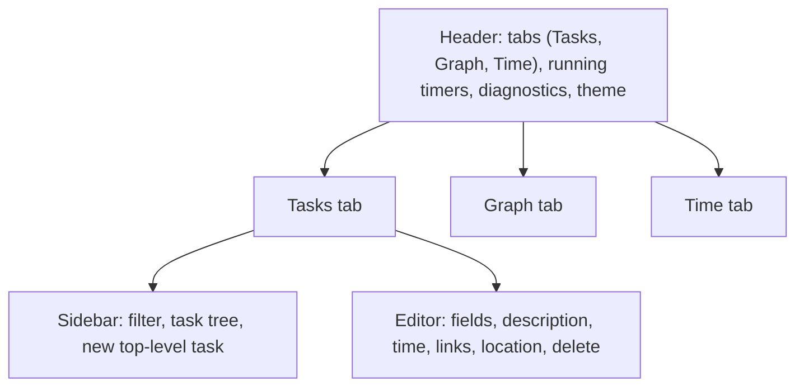
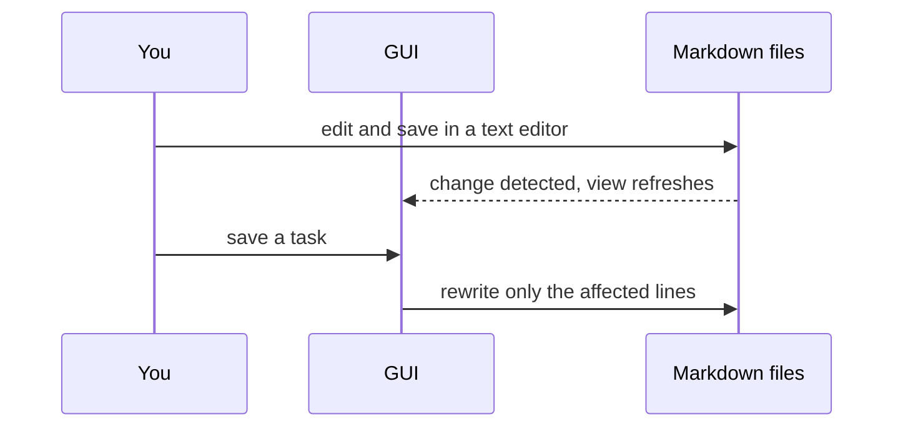

# Using the MaDo GUI

The MaDo GUI is a small web page that edits the task folder described in [Database.md](Database.md). Every change you make in it is written straight into the Markdown files, and every change made to the files (by you in an editor, by `git pull`, by anyone) shows up in the GUI within a fraction of a second.

## Starting it

MaDo needs Node.js 22 or newer.

```sh
npm install
npm run build
node dist/cli.js serve path/to/folder        # http://127.0.0.1:4848/
node dist/cli.js serve path/to/folder 5000   # a different port
```

Open the printed address in a browser. The server only listens on `127.0.0.1`, so the GUI is not reachable from other machines.

To try it out, serve the demo folder: `node dist/cli.js serve examples/demo`.

## The window



The **header** holds the three tabs, a button for every running timer (click it to jump to that task), and the diagnostics counter. Click the counter to show or hide the list of errors and warnings, each with its file and line number. The last button switches the color theme between automatic (follows the system), light and dark; the choice is remembered by the browser.

The address bar follows what you look at, so you can bookmark a view, share it with someone working on the same folder, or use the browser's back and forward buttons:

| Address | Shows |
|---|---|
| `/` | The Tasks tab with no task selected |
| `/view/<task-id>` | The Tasks tab with that task open |
| `/graph` | The Graph tab |
| `/time` | The Time tab |

A task's ID is the anchor a Markdown viewer gives its heading: `[Task] Animation system` becomes `task-animation-system`. If two tasks produce the same ID, later ones (in loading order) get `-1`, `-2` and so on appended. Renaming a task changes its ID, so old links to it stop selecting it.

## Tasks tab

### Sidebar

The **task tree** shows top-level tasks with their subtasks nested below them. A subtask that has several parents appears under each of them, but its own subtasks are expanded only once.

Each row shows:

- a **checkbox** that marks the task as done (it sets the `done` property),
- the **task type** badge and the **title**,
- the **time summary** `spent/effort h`, which includes all subtasks.

Click a row to open the task in the editor. Type in the **filter** box to show a flat list of the tasks whose type, title or description contains the text.

At the bottom, **add a top-level task**: pick its type, type a title, and choose the file it should go into. The task is appended to that file as a new `#` heading. Typing a file name that does not exist yet creates the file.

### Editor

The upper part of the editor holds the task's editable fields:

- **Type** and **Title.** Changing either renames the task in every file it appears in.
- **Done**, **effort (h)** and **spent (h).** The built-in properties.
- **One field per property** declared for the task's type in `mado-format.md`. Dates get a date picker; properties with an `enum` and booleans get a drop-down, where `(none)` removes the property. Hover over a field's name to see its description.
- **Description.** Plain Markdown text.

Properties that the type does not declare are listed read-only; edit them in the file.

Changes in this part are collected until you press **Save** (or Ctrl+S). **Revert** discards them. Only the fields you actually touched are written, merged onto the latest state of the file, so a property changed meanwhile in a text editor is not overwritten. While you have unsaved changes, the GUI will not switch to another task; save or revert first.

The lower part of the editor acts immediately:

- **Time.** *Start timer* records the start time in the task's `started` property. *Stop timer* adds the elapsed time to `spent`. Because the timer lives in the file, it keeps running when you close the browser or restart the server. The line next to the button sums effort and time over the task and all of its subtasks.
- **Links.** All links of the task, grouped by link type as seen from this task (a task that blocks this one is listed under *Blocked by*). Click a linked task to open it, or ✕ to remove the link. The ✕ is disabled for links that come from heading nesting, because those are changed by moving the heading in the file.
- **Link.** Choose a link type, then pick the target task. The suggestions only offer tasks whose type the chosen link type allows.
- **Add subtask.** Creates a new task as a bullet in the task's subtask list.
- **Stored in.** Every file and line where the task occurs. The occurrence marked *properties and description* is the one the editor writes to.
- **Delete.** Click twice. Deleting removes every occurrence of the task, including everything nested inside them.

## Graph tab

The graph shows tasks connected by links, flowing from left to right in the direction the links are declared. Each link type has its own color, explained in the legend. Subtask links are hidden by default; tick **Show subtask links** to include them.

A dashed line marks a link that closes a cycle (for example two tasks that block each other). Hover over a line to see its link type, and click a task to open it in the editor.

## Time tab

The first table lists every task in tree order with:

| Column | Meaning |
|---|---|
| Effort, Spent | The task's own `effort` and `spent`. |
| Σ Effort, Σ Spent | The same, summed over the task and all of its subtasks (each subtask counted once). |
| Progress | Σ Spent relative to Σ Effort. |

Rows shown in red have spent more time than estimated. The second table totals the tasks, finished tasks, effort and time per task type. All values are in hours.

## Working alongside a text editor

The GUI and your text editor can be used at the same time.



If a file changes on disk between the moment the GUI loaded it and the moment you save, the save is refused with a message, the GUI reloads, and you can simply save again. Nothing written by someone else is overwritten.

Errors such as an unknown task type or a link the format does not allow never block the GUI. They appear in the diagnostics list, and the affected tasks are still shown so you can fix them.
