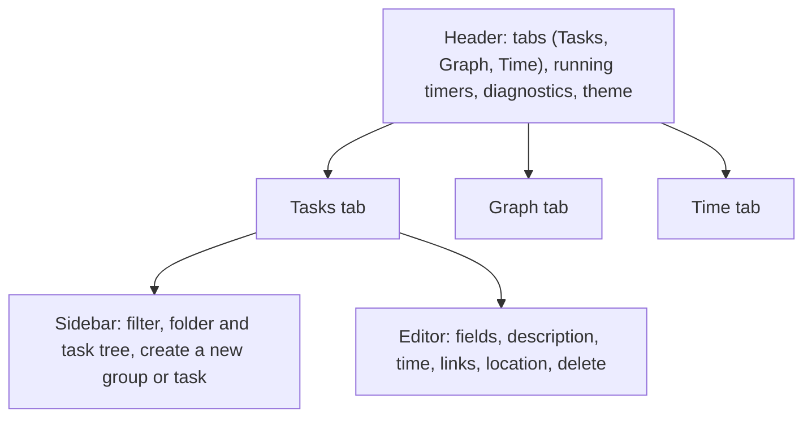
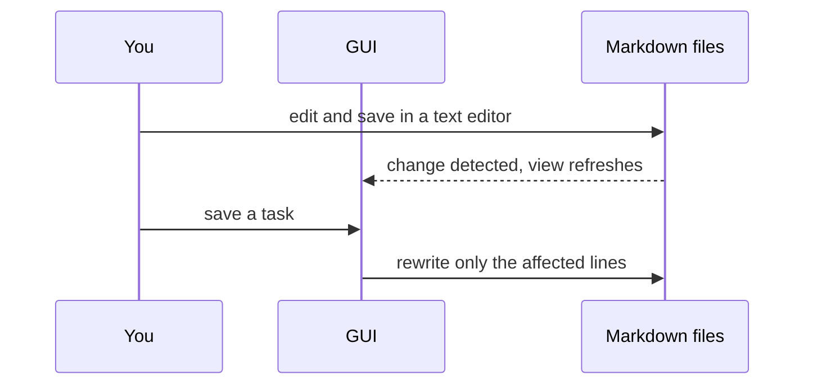

# Using the Plandown GUI

The Plandown GUI is a small web page that edits the task folder described in [Database.md](Database.md). Every change you make in it is written straight into the Markdown files, and every change made to the files (by you in an editor, by `git pull`, by anyone) shows up in the GUI within a fraction of a second.

## Starting it

Plandown needs Node.js 22 or newer.

```sh
npm install
npm run build
node dist/cli.js serve path/to/folder        # http://127.0.0.1:4848/
node dist/cli.js serve path/to/folder 5000   # a different port
```

Open the printed address in a browser. The server only listens on `127.0.0.1`, so the GUI is not reachable from other machines.

To try it out, serve the demo folder: `node dist/cli.js serve examples/demo`.

## The window



The **header** holds the three tabs, a button for every running timer (click it to jump to that task), and the diagnostics counter. Click the counter to show or hide the list of errors and warnings, each with its file and line number. The last button switches the color theme between automatic (follows the system), light and dark; the choice is remembered by the browser.

The address bar follows what you look at, so you can bookmark a view, share it with someone working on the same folder, or use the browser's back and forward buttons:

| Address | Shows |
|---|---|
| `/` | The Tasks tab with no task selected |
| `/view/<task-id>` | The Tasks tab with that task open |
| `/group/<path>` | The page of a folder or file, for example `/group/launch/press-kit` |
| `/graph` | The Graph tab |
| `/time` | The Time tab |

A task's ID is the anchor a Markdown viewer gives its heading: `[Task] Offline mode` becomes `task-offline-mode`. If two tasks produce the same ID, later ones (in loading order) get `-1`, `-2` and so on appended. Renaming a task changes its ID, so old links to it stop selecting it.

## Tasks tab

### Sidebar

The **tree** mirrors the folder. Folders (📁) and files (📄) are listed by name; inside each file, its top-level tasks are shown with their subtasks nested below them. A subtask that has several parents appears under each of them, but its own subtasks are expanded only once. A task whose parent lives in another file also counts as a top-level task of its own file. If that file sits directly inside its parent's node, the task is listed only there, not repeated under the parent; such nodes come first, in the order the parent lists its subtasks, followed by the rest by name.

Two kinds of nodes are merged, so the tree does not repeat the same name twice:

- A file and a folder with the same name (`design.md` next to `design/`) form one node. The file's tasks come first, followed by the folder's contents.
- A file holding a single top-level task named like the file is shown as that task. The comparison uses the task's ID, so `fix-login.md`, `Fix login.md` and `[Task] Fix login.md` all match `[Task] Fix login`. Renaming such a task in the GUI renames its file (and its same-named folder) too; if the new name is already taken, the rename is refused.

Each task row shows:

- a **checkbox** that marks the task as done (it sets the `done` property),
- the **task type** badge and the **title**,
- the **time summary** `spent/effort h`, which includes all subtasks.

A folder or file row is crossed out once every task inside it (at any depth) is done. Folders and files without any tasks never are.

Click a task row to open the task in the editor, or a folder or file row to open its page (see [Group pages](#group-pages)). Rows start collapsed. The arrow in front of a row collapses or expands its contents, and the tree keeps that choice. Clicking a row expands it too; clicking the open task's (or page's) expanded row again collapses it. While a task or page is open, however you got there (a click, a link, the back button or its address), the branches above its row are expanded unless you collapsed them yourself; they close again once you move on. Switching pages keeps the tree's scroll position, and the row you clicked stays where it was. The tree remembers its expanded and collapsed rows, and where it was scrolled to, across page reloads in the same browser tab. Clicking any row also selects it as the place where new items are created; click the empty space below the tree to clear that selection without leaving the open task. Type in the **filter** box to show a flat list of the tasks whose type, title or description contains the text.

At the bottom, **Create a new...** offers a *Group* button and one button per task type. Each opens a row in the tree where you type the name; Enter creates the item and Escape cancels.

- A **group** is an empty folder. It is created inside the selected folder, or next to the selected file or task (at the top of the folder if nothing is selected).
- A **task** is created as a top-level task near the selected row. When a subtask is selected, its file or folder decides:

| Selected | New task |
|---|---|
| Nothing | A new file at the top of the folder, named after the task |
| A file with several top-level tasks, or a file without its own task | A new `#` heading at the end of that file |
| A file merged with its task | A new file next to it, named after the new task |
| An empty folder | The folder is replaced by a file of the same name holding the task |
| Any other folder | A new file inside it, named after the task |

New file names are the task title without the characters that file systems reject (`/ \ : * ? " < > |`). If a file with that name already exists, the task is added to it.

#### Moving tasks, files and folders

Drag a row and drop it on another one to move it. Any link to a task or to a group page works the same way, so you can also drag a task chip from a link list, a graph node or a header timer, or even a link from another browser tab of the GUI. The items of a group page take drops just like tree rows (empty space there means the page's own folder or file). The tree highlights where the item will land:

- **Onto the middle of a task row:** the item becomes the last subtask of that task.
- **Onto the top or bottom edge of a task row:** the item lands just before or after that task, under the same parent.
- **Onto a folder or file row:** a task becomes a top-level task there, placed as described in the table above. A file or folder moves inside it; if the target is only a file, its folder is created. Folders and files are always sorted by name, so the whole row means *into*.
- **A folder or file onto a task row:** it moves into that task's file or folder (the one merged with the task, or else the node of the file the task lives in).
- **Onto the empty space below the tree:** the item moves to the top of the database. The tree always keeps a little space below its last row for this.

A task merged with its file always moves as that file, together with its same-named folder and everything in it. Its Subtask link moves too: the reference in its old parent (the task it was dragged from, or else the task merged with the folder it was in) is removed, and one is added to the new parent (the task it was dropped on, or the task merged with the target folder). Dropped before or after another subtask of the same parent, only the reference moves, which reorders it. In the filtered list, every drop goes into the row.

Moving any other task moves the text where its properties and description live, together with everything nested in it. Subtasks written as separate top-level sections of the same file (listed by the task, so shown only under it) follow it into the new file as level-1 headings, so the whole subtree moves. Any other list that mentions the task keeps mentioning it. The text adapts to its new place:

- Moved under another task, the heading becomes that task's last sub-heading, and all headings inside it shift by the same number of levels.
- Dropped next to a sibling that the parent lists as a reference bullet, a `- [Type] Title` reference takes that place in the list, and the heading becomes a level-1 heading at the end of that file. The same happens when the heading would have to be deeper than level 6.

A task cannot move under itself or any of its subtasks. A file left empty by a move (nothing but blank lines) is deleted. After a move, the moved task opens and its new row is selected.

The sidebar and the editor's property panel are resized by dragging their inner edge. **Hide** collapses either one to a thin strip; click the strip's arrow, or drag its edge outwards, to expand it again. Collapsed panes stay collapsed across page reloads in the same browser tab. The collapsed sidebar keeps its create buttons; clicking one expands the sidebar and opens the name input.

### Group pages

The page of a folder or file lists everything inside it as an outline: tasks with their subtasks, nested folders and files with their contents, each level indented below its parent. Every task appears as the same widget as in the link lists (see [Editor](#editor)), so you can tick it done, change its hours or run its timer without opening it; values of the same property line up in columns. The arrows collapse and expand branches, and the collapsed ones are remembered across page reloads in the same browser tab. Click a nested folder or file to open its page.

Drop a task, file or folder onto the outline to move it, exactly as in the [sidebar](#moving-tasks-files-and-folders). Dropped onto the empty space below the outline, it moves into the page's own folder or file.

### Editor

The upper part of the editor holds the task's editable fields:

- **Title** (at the top) and **Type.** Changing either renames the task in every file it appears in.
- **Done**, **effort (h)** and **spent (h).** The properties playing the `done`, `effort` and `spent` roles (see the format description in Database.md); a type without them shows no such fields.
- **One field per property** declared for the task's type in `plandown-format.md`. Dates get a date picker; properties with an `enum` and booleans get a drop-down, where `(none)` removes the property. Hover over a field's name to see its description.
- **Description.** Markdown text. Lists of linked tasks in it are shown below the description, as the interactive link lists described below. A list followed by more text leaves a marker at its place in the text; click the marker to scroll to the list. The description stretches to fill the page, so the link lists sit at the bottom.

Properties that the type does not declare are listed read-only; edit them in the file.

Changes in this part are collected until you press **Save** (or Ctrl+S). **Revert** discards them. Both buttons appear next to the title as soon as anything is changed, and they apply to the whole task. Only the fields you actually touched are written, merged onto the latest state of the file, so a property changed meanwhile in a text editor is not overwritten. While you have unsaved changes, the GUI will not switch to another task; save or revert first.

The rest of the editor acts immediately:

- **Time.** *Start timer* records the start time in the task's `started` property. *Stop timer* adds the elapsed time to `spent`, and *Log elapsed* does the same while keeping the timer running from zero. To record time without the timer, click **+h** next to the `spent` field, type the hours and press *Add* (or Enter); they are added to `spent` (a negative number corrects an earlier entry). Because the timer lives in the file, it keeps running when you close the browser or restart the server. The line next to the button sums effort and time over the task and all of its subtasks.
- **Links.** All links of the task, grouped by link type as seen from this task (a task that blocks this one is listed under *Blocked by*). Each linked task appears as a small widget: click its title to open it, or change its `done`, `effort` and `spent` values, log hours with **+h** and start or stop its timer right there. Values of the same property line up in columns within each list. Hover over a row to reveal its removal button:
  - **✕** deletes a link this task declares. If the linked task declares the same link too, only this task's entry is removed, and the row stays as an incoming link.
  - **Unlink** (the broken chain) removes a link that only the linked task declares, by editing the linked task.

  Subtask and parent links have no removal button; change them in the files.

  Drop a task onto a list to link it: the reference lands before or after the row under the pointer (the upper or lower half), or at the end of the list. Dropping a task the list already shows reorders it instead. A reference this task declares moves within its list, together with any text nested under it, and a subtask written as a sub-heading moves like a [sidebar drop](#moving-tasks-files-and-folders) next to its new sibling. A link only the other task declares keeps its place; reorder it on that task's page. Dropping onto a list never moves the task's own text; a Subtask list therefore only adds a reference.
- **Link.** Choose a link type, then pick the target task. The suggestions only offer tasks whose type the chosen link type allows. Only link types declared by this task's type can be created here; incoming one-directional links (and parents) are created on the other task's page.
- **Add subtask.** Creates a new task as the last sub-heading of the task's section.
- **Stored in.** Every file and line where the task occurs. The occurrence marked *properties and description* is the one the editor writes to.
- **Delete.** Click twice. Deleting removes every occurrence of the task, including everything nested inside them.

### Text editing

The title, the description and text properties share one editor. It shows formatted text; click into it to edit, and the text stays exactly where it is. Markdown markers (such as `**` for bold or `##` for a heading) appear beside the formatted text while the cursor is in it. A toolbar appears above the field, or below it when there is no room above, with buttons for common formatting on the left and a ✓ on the right that finishes editing.

Formatting applies to the selected text instead of replacing it, whether you click a button or type a marker over the selection. Each marker toggles its style, so pressing it again removes the style:

- `*` or `_` steps through italic, bold, bold italic and plain text; **B** and **I** (Ctrl+B, Ctrl+I) switch bold or italic alone.
- `~` or `-` strikes the text through (always written as `~~`).
- `` ` `` makes inline code, or a code block when the selection spans several lines.
- `$` marks a formula.
- `[` turns the text into a link.
- `#` cycles the heading level and `>` makes a quote (both apply to whole lines, and only in multi-line fields).

Inside a code block, typed markers replace the selection as usual (except `` ` ``).

Line breaks follow Markdown. A single newline inside a paragraph is shown as a space, so text written with hard-wrapped lines flows as one paragraph. When you edit such a paragraph, it is saved with its newlines where the editor wraps it on screen; paragraphs you did not touch keep their lines. A line ending with a backslash (`\`) or with two or more spaces breaks the line, which is what Shift+Enter inserts; a `↵` marker shows where it is.

A fenced code block tagged `mermaid` is drawn as a [Mermaid](https://mermaid.js.org) diagram. Its code stays hidden; the **Source** button below the diagram shows it for editing, and the diagram follows your changes as you type. While the code has an error, the last working diagram stays dimmed and hovering it shows the error message.

| Key | Effect |
| --- | --- |
| Enter | In the description, a new paragraph (in lists, tables and code blocks: a new item, row or line). In other fields, finishes editing; once a field has several lines, acts as in the description. |
| Shift+Enter | A line break within the paragraph (the title is always a single line). |
| Ctrl+Enter | Finishes editing, like ✓. |
| Ctrl+B, Ctrl+I | Bold, italic. |
| Ctrl+Z, Ctrl+Shift+Z | Undo, redo. |
| Ctrl+click | Opens a link. |

Drag the lower right corner of the description to resize it.

## Graph tab

The graph shows tasks connected by links, flowing from left to right in the direction the links are declared. Each link type has its own color, explained in the legend. Subtask links are hidden by default; tick **Show subtask links** to include them.

A dashed line marks a link that closes a cycle (for example two tasks that block each other). Hover over a line to see its link type, and click a task to open it in the editor.

## Time tab

The first table lists every task in tree order with:

| Column | Meaning |
|---|---|
| Effort, Spent | The task's own `effort` and `spent`, or a gray `-` when the task has no such property. |
| Σ Effort, Σ Spent | The same, summed over the task and all of its subtasks (each subtask counted once). |
| Progress | Σ Spent relative to Σ Effort. |
| (last) | The task's timer button. It appears while you hover the row or the task is selected, and stays visible while the timer runs. |

Rows shown in red have spent more time than estimated. The second table totals the tasks, finished tasks, effort and time per task type. All values are in hours.

## Working alongside a text editor

The GUI and your text editor can be used at the same time.



If a file changes on disk between the moment the GUI loaded it and the moment you save, the save is refused with a message, the GUI reloads, and you can simply save again. Nothing written by someone else is overwritten.

#### Links you can drag and drop

Every drop target accepts any link that names a task, a folder or a file of the open database:

- links of the GUI itself (`/view/…` and `/group/…`), from this page, another tab or any address of the server;
- file paths relative to the database folder, such as `tasks/login.md` or `tasks/login.md#task-fix-login` (the anchor names a task inside the file), which is what **Copy link** copies.

When the GUI is opened from the VSCode extension, absolute paths, `file:` links and paths relative to the workspace folder work too.

Errors such as an unknown task type or a link the format does not allow never block the GUI. They appear in the diagnostics list, and the affected tasks are still shown so you can fix them.
